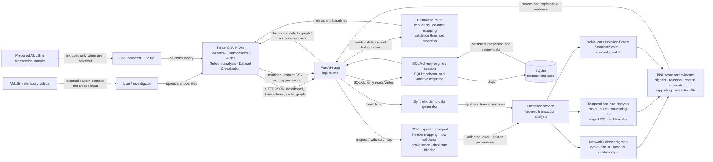

# ClearTrace — Architectural Overview

## 1. System Architecture

ClearTrace is a **local client-server application implemented as a layered modular monolith**. The React/Vite single-page interface calls one FastAPI application over HTTP. FastAPI routes coordinate validation, detection services, and SQLAlchemy persistence to a local SQLite database. The graph, temporal, rule, and Isolation Forest analyses run synchronously inside the backend process during demo loading or CSV import.

It is not a microservice system: there is one frontend app, one backend process, and one primary database table. The code has useful module boundaries, but route handlers still perform much of the orchestration. There is no authentication service, job queue, cloud service, external scoring API, or automatic AMLSim download.

| Concern | Implemented component |
|---|---|
| User interface | React 19 SPA served by Vite; `src/App.jsx` owns page state and renders the screens |
| HTTP/API | FastAPI router under `/api`; browser requests use `fetch` |
| Import and validation | `services/dataset_import.py`, called by upload/inspect routes |
| Detection | `services/detection.py`: NetworkX graph analysis, temporal/rule signals, scikit-learn Isolation Forest, weighted risk score |
| Persistence | SQLAlchemy session and one SQLite `transactions` table |
| External data | User-selected CSV files. AMLSim files are present locally; ClearTrace does not fetch them or import `alerts.csv` automatically |

The backend uses `DATABASE_URL` for the SQLAlchemy engine, defaulting to `sqlite:///./aml_detection.db`. The migration helper is specifically SQLite-oriented and adds columns to the existing table.

## 2. Architecture Diagram



`alerts.csv` is shown as a sidecar because it is not part of the application data flow. The preparation script reads AMLSim `transactions.csv` separately to create the checked-in 50,000-row sample.

## 3. Frontend Architecture

The frontend is a **single React application**, not a collection of separately routed pages. `src/main.jsx` mounts `App` and imports the two CSS files. `App.jsx` stores the active page and application data in React state, fetches API responses, and conditionally renders the selected screen.

| Screen / component | Actual responsibility |
|---|---|
| Overview | Dashboard statistics, transaction-activity area chart, severity distribution, and recent priority alerts |
| Transactions | Search/severity filtering and transaction table; selecting a row opens the investigation drawer |
| Alerts | Status tabs, alert evidence summary, investigation action, and review action |
| Network analysis | Cytoscape account nodes and directed transfer edges; selecting an edge opens transaction detail |
| Dataset & evaluation | Label confirmation inputs, evaluation request, metrics and baseline display |
| Dataset import dialog/report | CSV preview and mappings, timestamp meaning, scope/configuration, validation results and duplicate counts |
| Detail drawer | Transaction risk-signal scores, reasons, related accounts, supporting IDs, source label and status action |

`App.jsx` also contains presentational components such as `Stat`, `Signal`, `RiskBadge`, `Status`, and `TransactionTable`. There is no React Router or separate frontend API client module; a small `request` helper in `App.jsx` calls the backend. A refresh fetches dashboard, transaction list, alerts, and graph data concurrently.

| Library | Use in this codebase |
|---|---|
| React / React DOM | UI composition and state |
| Vite + React plugin | Development server and production build |
| Tailwind CSS + Vite plugin | Tailwind integration; the UI also uses substantial project-specific CSS in `styles.css` and `import.css` |
| Recharts | Overview activity `AreaChart` |
| Cytoscape.js | Interactive account relationship graph |
| Lucide React | Interface icons |

## 4. Backend Architecture

`backend/app/main.py` creates the FastAPI application, configures CORS, includes the `/api` router, and runs `Base.metadata.create_all()` plus the additive SQLite-column migration during application lifespan startup.

| Module | Responsibility and dependencies |
|---|---|
| `api/routes.py` | HTTP endpoints; calls SQLAlchemy, importer, demo generator and detection service; serializes database rows and evaluation metrics |
| `schemas/transaction.py` | Pydantic transaction input/output shapes; requires exactly one of calendar timestamp or simulation step and permits non-negative amounts |
| `services/dataset_import.py` | CSV inspection, aliases/header inference, canonical IDs, explicit date/step parsing, field validation, invalid-row reporting, source-label and provenance retention |
| `services/detection.py` | `DetectionConfig`, chronological feature preparation, graph/temporal/rule/Isolation Forest signals, risk scoring and evidence |
| `services/demo.py` | Deterministic synthetic transactions for the demo, including deliberate cycle and rapid-transfer examples |
| `models/transaction.py` | SQLAlchemy mapping for the `transactions` table |
| `db/database.py` | Environment loading, engine/session creation, request-scoped `get_db`, table-column migration |

### API endpoints

All application endpoints use the `/api` prefix.

| Method and path | Behavior |
|---|---|
| `GET /api/health` | Basic service health response |
| `POST /api/demo/load` | Generates and inserts synthetic demo rows; existing transaction IDs are skipped |
| `GET /api/dashboard` | Computes transaction/alert/account counts, currency-aware totals or warning, activity buckets, and recent alerts from stored rows |
| `GET /api/transactions` | Returns a paginated transaction list with text search, severity and review-status filters |
| `POST /api/transactions/inspect` | Reads a CSV and returns normalized headers, inferred mapping, and up to five preview rows |
| `POST /api/transactions/upload` | Accepts multipart CSV, mapping/config/scope/timestamp-kind fields; validates, de-duplicates, analyzes and stores rows; returns invalid-row and duplicate counts |
| `GET /api/alerts` | Returns transactions whose stored risk score meets their stored alert threshold; filters by status/severity |
| `PATCH /api/alerts/{transaction_id}/status` | Changes a transaction’s status to `open`, `reviewing`, or `closed` |
| `GET /api/graph` | Builds graph node/edge response data from transaction rows, optionally filtered by account text |
| `GET /api/evaluation` | Requires label verification and exact positive/negative label strings; returns validation-selected evaluation metrics and baselines when both partitions contain both classes |

FastAPI’s default documentation is available at `/docs` when the backend is running. Routes are the HTTP orchestration layer; there is no separate controller/repository/domain-service framework beyond these modules.

## 5. Detection Engine

For a valid import or demo batch, the implemented path is:

1. **Validate and normalize.** `import_csv` normalizes headers, infers common CSV/AMLSim aliases, applies user mappings, checks row width, amount, currency shape, required accounts and timestamp format. Simulation timestamps must be non-negative integers and remain simulation steps. `TransactionIn` enforces one time representation. Invalid rows are returned with source row numbers.
2. **Create internal identity and provenance.** Source transaction IDs are retained separately. Internal IDs are deterministic hashes scoped by dataset name and source ID; when there is no source ID the filename, row and contents contribute. Source label, source alert ID, dataset name, row number, raw timestamp value and original row are retained.
3. **Choose analysis population.** Upload scope is either the incoming import or all eligible imported rows. The combined scope rejects mixing calendar timestamps and simulation steps. Local demo rows are excluded from imported-only analysis. Existing imported rows are rescored when the combined scope is requested.
4. **Build causally ordered features.** Rows are ordered by timestamp/step, with transaction ID stabilizing ties. Isolation Forest features include past account counts, account-relative amounts, source-unit/currency-scoped relative amount behavior and calendar time-of-day. Feature history for tied rows is computed from before the tied slice. Unknown currency amounts are not converted or used by USD threshold rules.
5. **Graph analysis.** A directed NetworkX graph is checked for bounded return paths (default maximum six accounts). Tied rows are handled as a graph slice. The service also scores destination fan-in over a configured window and high prior account activity. The graph is used in memory; graph nodes are not a separate database entity.
6. **Temporal and rule signals.** Per-account history supports rapid repeated outgoing transfers, incoming-to-outgoing pass-through, repeated small USD transfers, short-window bursts, and same-step/same-day activity. Rules include a large known-USD transfer and self-transfer. Step windows use simulation steps, not invented clock durations. USD structuring/large-transfer rules do not run for unknown currency.
7. **Unsupervised anomaly scoring.** A `StandardScaler` and seeded `IsolationForest` (120 estimators, `contamination="auto"`) are fit on the chronological training segment. Training scores calibrate anomaly values; the fitted model scores validation and holdout rows. Labels and source alert IDs are not detector features.
8. **Calculate score and evidence.** Rule, graph, temporal and anomaly components are normalized by their configured total weights (defaults 0.25, 0.30, 0.25, 0.20). The integer risk score is in 0–100. Reasons, contributing signal names, related accounts and supporting transaction IDs are stored. Rows at or above their configured `alert_threshold` are returned as alerts by the alerts route; there is no separate alert table.
9. **Review.** The status field belongs to the transaction row. The API changes it in place; there is no separate review-event/audit-history table.

`DetectionConfig` validates positive windows/counts, score weights and alert threshold. The import UI exposes key windows/weights; additional configuration fields are accepted through the API’s JSON `detection_config` form field. The evidence is investigative triage, not a finding of laundering.

## 6. Database Architecture

The configured local database is SQLite. SQLAlchemy creates one mapped table, `transactions`, with an integer surrogate primary key and unique indexed `transaction_id`. The source code does not define persistent `Account`, `Alert`, or `Evidence` tables and does not declare ORM relationships among those entities.

Transaction rows store sender, receiver, amount/currency metadata, channel/description, calendar timestamp or `simulation_step`, import ID, source transaction ID/alert ID/label/dataset/row/raw record, risk component scores, threshold, serialized reasons/signals/related accounts/supporting transaction IDs, evaluation/validation eligibility and review status. Several list/object fields are JSON-encoded text columns.

Account counts and graph nodes are derived from sender/receiver values. An “alert” is a transaction row whose risk score meets its stored alert threshold. Its evidence is stored on that same row. Review status is also stored there; changes overwrite the current status rather than recording status history.

CSV import is additive. Existing internal transaction IDs are filtered before insert, and repeated source IDs under the same dataset name resolve to the same internal ID. Duplicate IDs inside one file are skipped and reported; malformed rows are returned as invalid. A different dataset name creates a different ID namespace. Demo data is not replaced by normal import. The startup migration adds missing SQLite columns and does not rebuild/reset the table.

## 7. End-to-End Data Flow

1. **Dashboard opens:** the React `useEffect` refresh calls `/dashboard`, `/transactions`, `/alerts`, and `/graph`; the API reads current SQLite rows and returns aggregates and lists.
2. **CSV selected:** the browser sends the selected file to `/transactions/inspect`. The dialog displays detected headers/sample and lets the user confirm columns, dataset name, calendar-vs-step meaning, scope and detector config.
3. **Import and scoring:** the browser submits multipart data to `/transactions/upload`. The route reads the file, importer validates and maps rows, the route de-duplicates and calls `detect`, then SQLAlchemy writes source data and scores to SQLite.
4. **Alerts displayed:** the UI loads `/alerts`; the route selects stored rows meeting their configured threshold. Dashboard alert totals use the same score/threshold condition.
5. **Investigation:** selecting a transaction or graph edge opens the detail drawer. It shows component scores, reasons, related accounts, supporting transaction IDs, source label and provenance included in the API response.
6. **Review status changed:** the UI sends `PATCH /alerts/{transaction_id}/status?status=...`; the route updates and commits the row, then the UI refreshes.
7. **Evaluation:** the user explicitly confirms exact source positive/negative label strings. The UI calls `/evaluation`; the endpoint maps only those strings, selects an evaluation threshold using validation labels, evaluates on the later holdout, and returns all-negative and fixed-threshold comparisons.

## 8. Machine Learning and Evaluation

### Implemented model and split

- Algorithm: scikit-learn `IsolationForest`, preceded by `StandardScaler`; random seed 42 and 120 trees. It is unsupervised: source labels do not enter model fitting or detector features.
- Features: past sender/receiver activity counts, account-relative amount features, group-relative amount features and time-of-day for calendar data. Known currencies are separate. Missing-currency rows use source-dataset-scoped relative values rather than currency conversion or USD rules.
- For a normal-sized chronological population, the detector uses approximately 56% training, 14% validation and 30% holdout. Simulation-step (and timestamp) groups are kept intact at boundaries; actual row shares can differ slightly due to group alignment. Small populations may not have enough rows/classes for evaluation.
- The API maps only exact caller-specified `source_label` strings, and only rows explicitly marked validation or holdout eligible. It selects the threshold on validation data by F1 under a default maximum validation FPR of 1%; if no validation positives are detected, it falls back to sentinel threshold 101 (all-negative). It then reports holdout metrics, plus an all-negative baseline and the fixed detector-threshold baseline (default 40). The evaluation cutoff does not automatically change the live alert threshold.
- Reported metrics: precision, recall, F1, false-positive rate, TP/FP/TN/FN, sample counts and class proportions. Accuracy is not the primary metric and is not returned.

### AMLSim and limitations

The local prepared sample is a reproducible **uniform Algorithm R reservoir sample** of 50,000 rows from 12,476,012 source transactions, selected in one streaming pass with seed 42 and restored to source order. It preserves simulation steps 0–199, original IDs, labels and fields. It contains 49,918 `False` and 82 `True` labels (0.164% positive in the sample). These are synthetic AMLSim labels, not verified real-world laundering findings.

The detector’s last measured result on this sample was poor. The recorded original fixed-40 run on 15,018 holdout rows (32 positives, 14,986 negatives) had TP 0, FP 4, TN 14,982, FN 32; precision, recall and F1 were 0, with FPR 0.000267. After the feature/split improvements, validation had only six positive examples and detected none under the default 1% validation-FPR cap, so the selected evaluation cutoff was 101. Its holdout result matched the all-negative baseline: TP 0, FP 0, TN 14,986, FN 32; precision/recall/F1 0 and FPR 0. The fixed-40 comparison after those changes had TP 0, FP 51, TN 14,935, FN 32; precision/recall/F1 0 and FPR 0.003403. **These changes did not improve positive detection.**

The random transaction-level sample retains only about 0.4% of the source edges, so most multi-transaction cycle and fan-in context is absent. Inspection of the matching sidecar identified 39 cycle and 43 fan-in annotations among the 82 sampled positives; that sidecar and `ALERT_ID` are not detector inputs because they expose source alert outcomes and would leak the target. The transaction CSV's `ALERT_ID` is retained as source metadata; `alerts.csv` itself is not ingested. The full 595 MB transactions file is not loaded by the app: the current API reads each upload into memory and constructs a row list. The prepared 2.4 MB sample is the practical demo input; full-source ingestion needs a separate batch/streaming design.

Other limitations: no currency conversion; unknown currencies suppress monetary totals and USD rules; alert threshold calibration is evaluation-only; metrics from this small, imbalanced synthetic sample are unstable; no production monitoring/calibration claim is supported.

## 9. Deployment and Technology Stack

| Layer | Verified implementation |
|---|---|
| Languages | JavaScript/JSX, Python, CSS, HTML; SQL through SQLAlchemy and SQLite |
| Frontend | React 19, Vite 7, Tailwind CSS 4 integration, Recharts, Cytoscape.js, Lucide React |
| Backend | Python 3.13-compatible requirements; FastAPI, Uvicorn, Pydantic, SQLAlchemy, Pandas, NumPy, scikit-learn, NetworkX |
| Database | Local SQLite file, configured through `DATABASE_URL` |
| Development ports | Vite defaults to `http://localhost:5173`; README starts Uvicorn at `http://localhost:8000`; API root prefix `/api`; FastAPI docs at `/docs` |
| Configuration | `.env.example`: `DATABASE_URL`, `API_CORS_ORIGINS`, `VITE_API_URL`; frontend falls back to `http://localhost:8000/api` |

The documented run mode is local development (`uvicorn --reload` plus `npm.cmd run dev`). `npm.cmd run build` creates static frontend assets and `npm.cmd run preview` previews them, but the repository does not provide a production backend deployment, reverse proxy, container configuration, cloud setup, authentication, or operational monitoring. SQLite is the implemented and documented starting database; the additive migration code is SQLite-specific.

## 10. Project Structure

```text
.
├── src/
│   ├── App.jsx                 # SPA state, screens, import/evaluation and API calls
│   ├── main.jsx                # React mount
│   ├── styles.css              # Main UI styles and Tailwind import
│   └── import.css              # Import dialog/report styles
├── backend/
│   ├── app/
│   │   ├── main.py             # FastAPI app, CORS, startup schema/migration
│   │   ├── api/routes.py       # HTTP routes and orchestration
│   │   ├── db/database.py      # SQLAlchemy engine, sessions and SQLite migration
│   │   ├── models/transaction.py
│   │   ├── schemas/transaction.py
│   │   └── services/
│   │       ├── dataset_import.py
│   │       ├── detection.py
│   │       └── demo.py
│   ├── requirements.txt
│   └── tests/                  # API, import and detection tests
├── scripts/prepare_amlsim_sample.py
├── data/processed/             # Prepared sample and small manifest
├── 100Kvertices-10Medges/      # Local AMLSim source files (not app-managed)
├── package.json / package-lock.json
├── vite.config.js
├── .env.example
├── README.md
└── aml_detection.db            # Local SQLite database
```

`dist/`, `.venv/`, and `node_modules/` are generated/build or environment directories, not application source modules.

## 11. Architecture Summary

### Viva-ready explanation

ClearTrace is a local web application with a React/Vite frontend and a FastAPI backend. The frontend sends JSON and CSV uploads to REST endpoints. The backend validates and maps transaction rows, analyzes them with a directed graph, temporal and rule checks, and an unsupervised Isolation Forest, then stores the transaction, risk score, source provenance and evidence in SQLite. The dashboard derives alerts from scored transaction rows, and an investigator can inspect evidence and update the row’s review status. Evaluation keeps explicitly mapped synthetic source labels separate from detector inputs and reports results on a later chronological holdout. Current AMLSim results show no positive detections, so the system is a demonstrator rather than an effective production AML detector.

### Five key modules

1. `src/App.jsx` — browser screens, UI state, import workflow and API requests.
2. `backend/app/api/routes.py` — HTTP contract and coordination of persistence, import, detection and evaluation.
3. `backend/app/services/dataset_import.py` — CSV schema inference, row validation, mapping, stable IDs and source provenance.
4. `backend/app/services/detection.py` — graph, temporal, rule, anomaly and evidence scoring.
5. `backend/app/db/database.py` + `models/transaction.py` — SQLite connection/session and transaction persistence.

### Strengths and limitations

**Strengths:** small local setup; clear API/UI separation; modular CSV and detection services; provenance and exact source-label mapping; deterministic synthetic demo and Isolation Forest; evidence attached to each scored row; additive schema updates; focused test coverage.

**Limitations / technical debt:** a single large `App.jsx` and route module; one transaction table represents transactions, generated alerts, evidence and review status; no account table or review audit history; entire CSV uploads are read and processed in memory; no background progress for large jobs; sample-level graph context is sparse; current measured positive recall is zero; evaluation labels and small validation positives are synthetic and imbalanced; fixed live alert threshold is not automatically updated by evaluation; no external AMLSim integration, auth, production deployment, or monitoring.

### Intended versus actual

The intended product is a broader AI-assisted AML investigation system with graph, temporal, rule and anomaly signals. The implemented application is a working local prototype of that workflow. It imports user-selected CSVs, provides explainable triage and status updates, and runs an Isolation Forest; it does not establish money laundering, connect to bank systems, automatically ingest sidecar alert/account files, or demonstrate effective AMLSim positive detection. The recorded backend result was **21 passed** and the Vite production build succeeded in the preceding implementation verification; this documentation-only task did not rerun the test suite or build.
